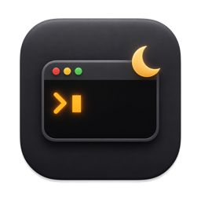
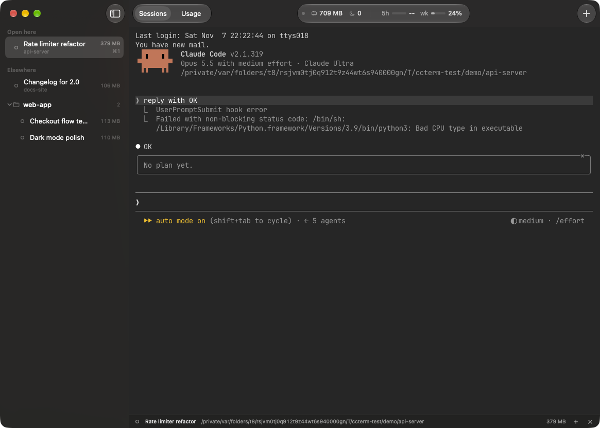

<p align="center"></p>

# ClaudeTerm

A native macOS terminal for running many Claude Code sessions. It comes with `ccgovd`, a daemon that puts idle sessions to sleep so they stop using memory.



## Why

- **One window.** Every Claude Code session on the Mac, grouped by status, with live memory.
- **Nothing lost.** Quit or reboot, and each pane comes back with `claude --resume`.
- **Less memory.** 8 idle sessions went from 1.5 GB to 0 after one daemon cycle.
- **Real terminal.** Panes run on libghostty.

## Features

| App | Daemon (`ccgovd`) |
|---|---|
| Sidebar sections: *Needs you*, *Open here*, *Elsewhere*, *Asleep* | Session index with memory and CPU per process tree |
| Memory bar per session, totals in the toolbar | Moves unfocused idle sessions to background priority |
| 5-hour and weekly quota in the toolbar, from Claude Code | Hibernates sessions idle for 30 min, resumes them on click |
| Right-click: pin, hibernate, reveal, copy resume command | Read-only unless started with `--govern` |
| Usage tab: daily cost; hover a day for tokens and models (ccusage) | Checks a process's identity before signalling it |

## Shortcuts

| Keys | Action |
|---|---|
| Cmd-1 ... Cmd-8, Cmd-9 | Pane 1 to 8, last pane |
| Ctrl-Tab, Cmd-Shift-] / [ | Next / previous pane |
| Cmd-Option-Down / Up | Next / previous session in the sidebar |
| Cmd-Ctrl-1 / 2, Cmd-Shift-U | Sessions / Usage tab |
| Cmd-N, Cmd-Shift-N | New session, new session in this project |
| Cmd-Shift-W, Cmd-Ctrl-S | Close pane, toggle sidebar |

## Performance

Idle sessions, measured on 2026-11-07.

| | App | 8 idle sessions |
|---|---|---|
| Terminal.app | 56 MB | ~4.9 GB |
| Claude desktop app | 1.7 GB | not measured |
| ClaudeTerm | 81 MB | ~4.9 GB |
| ClaudeTerm + `ccgovd --govern` | 81 MB | **0** |

## Install

Needs macOS 14+, Xcode, Claude Code 2.1.319+, and SSH access to this repo.

```sh
brew install 0xnicholasy/tap/claudeterm
ln -sf "$(brew --prefix claudeterm)/ClaudeTerm.app" /Applications/ClaudeTerm.app
brew services start claudeterm   # optional: ccgovd daemon, read-only
```

For the daemon to demote and hibernate idle sessions, run `ccgovd run --govern`.

## Build from source

```sh
scripts/build-app.sh           # builds build/ClaudeTerm.app
cd ccgovd && make install-daemon
```

Hook setup: [`ccgovd/hooks/README.md`](ccgovd/hooks/README.md). Design notes: [`docs/design.md`](docs/design.md).
